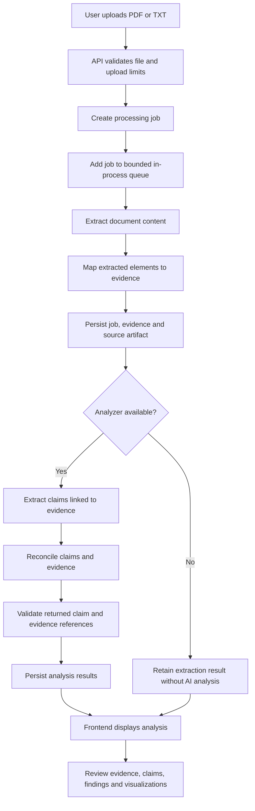
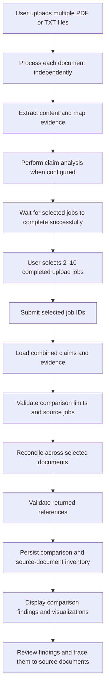

# 4. Architecture and data flow

**Document type:** Technical architecture guide  
**Audience:** Developers, reviewers, and maintainers  
**Status:** Current source layout as on 30th October 2026  
**Purpose:** Describe the components, processing sequence, persistence, and provider selection implemented in the repository.

## High-level components

| Component | Location | Responsibility |
|---|---|---|
| FastAPI application | `app/main.py` | Creates the API, configures CORS, starts/stops the job manager, exposes health/readiness |
| API routes and schemas | `app/api/routes.py`, `app/api/schemas.py` | Upload, status, evidence, analysis, comparison, history, and Tavily endpoints |
| Settings and logging | `app/core/config.py`, `app/core/logging.py` | Loads environment settings and configures logging |
| Ingestion | `app/ingestion/` | Selects extractors and maps extracted content into evidence |
| Evidence model | `app/evidence/` | Defines evidence objects and their provenance-related data |
| Job manager and store | `app/jobs/` | Runs the bounded extraction queue and persists jobs in SQLite |
| Reasoning | `app/reasoning/` | Selects the analyzer, calls Nebius or offline demo behavior, and validates results |
| Frontend | `frontend/src/` | React + TypeScript user interface, upload flows, charts, history, and API client |
| Evaluation | `evaluation/`, `scripts/run_evaluation.py` | Curated synthetic regression benchmark |
| Tests | `tests/` | Unit, API, contract, extraction, and provider behavior checks |

## Single-document processing flow

A single-document analysis starts when a user uploads a supported PDF or TXT file. The application validates the upload, creates a processing job, extracts document content, maps extracted content to evidence, and then performs claim analysis and reconciliation when an analyzer is available.

### Single-document workflow diagram

### Processing steps

1. **Upload:** The client sends a PDF or UTF-8 TXT file to `POST /api/v1/artifacts`.
2. **Validation:** The API checks filename, media type, content, size, and queue capacity.
3. **Queue:** A bounded in-process queue accepts a job. The API returns a job ID and current status.
4. **Extraction:** The selected extractor runs. PDF extraction uses the Docling runtime; TXT uses the text extractor.
5. **Evidence mapping:** Extracted elements are mapped into evidence objects with source and provenance information.
6. **Persistence:** Job state, extracted result, evidence, claims, findings, and relevant metadata are stored through the SQLite-backed job store. Source artifacts are stored under the configured data directory with generated names.
7. **Claim analysis:** If an analyzer is configured, the reasoning layer produces claims linked to extracted evidence.
8. **Reconciliation:** The model-backed flow assesses the supplied claims and evidence and returns candidate findings. The application validates the returned references before exposing them.
9. **Review:** The frontend polls status and renders evidence, claims, findings, charts, and traceability.

Extraction can succeed even if AI analysis is not configured or fails. The API exposes extraction and analysis state separately.

## Cross-document processing flow

Multi-document comparison builds on the single-document workflow. Each selected document must first complete its normal processing and claim analysis. The user can then select completed upload jobs for comparison.

### Multi-document comparison workflow diagram

### Processing steps

1. Each selected document is uploaded and processed through the normal single-document pipeline.
2. The frontend waits for each source job to complete extraction and claim analysis.
3. The client sends the completed job IDs to `POST /api/v1/comparisons`.
4. The job manager loads the combined evidence and claims and checks comparison limits.
5. The analyzer compares the combined source material and returns findings.
6. The application validates finding references against the combined evidence and claim IDs.
7. The comparison is saved and returned with its source-document inventory, claims, findings, and evidence-source references.

Limits in the current comparison path include 2–10 documents, up to 120 claims, up to 1,000 evidence objects, and the configured aggregate claim-text limit. Comparisons are performed during the request rather than as a separate persisted background comparison job lifecycle.

## Persistence and history

The default data directory is `data/`, with:

- `data/realitycheck.sqlite3` for local job/comparison metadata and stored analysis records.
- `data/artifacts/` for uploaded source files.

History combines standalone document analyses and saved comparisons. Source jobs associated with a saved comparison are grouped under that comparison in the top-level history list. Retention cleanup applies to terminal jobs; default retention is 30 days.

## Provider selection

| `ANALYSIS_PROVIDER` | Behavior |
|---|---|
| `auto` | Use Nebius when a non-empty `NEBIUS_API_KEY` is configured; otherwise leave analysis disabled and run extraction-only |
| `nebius` | Require a configured key and use the Nebius Token Factory analyzer |
| `offline` | Use the deterministic offline demonstration analyzer; no model/API call |

The default model IDs in configuration are `nvidia/nemotron-3-nano-30b-a3b` for claim extraction and `nvidia/nemotron-3-super-120b-a12b` for reasoning. These are configured defaults, not guarantees of account access.

## Design boundaries visible in the code

- The job queue is in-process and intended for a single API process.
- SQLite and the local artifact directory are used; a shared distributed job system is not implemented.
- The application does not implement login or per-user authorization.
- Tavily is a separate explicit search endpoint. It receives the public query and optional domain restrictions, not the uploaded document text.
- The repository does not implement a vector database or embedding-based retrieval pipeline as its core analysis path.

## Example: tracing a comparison

For a comparison result, start with the comparison ID. The saved comparison contains the source document list, claims, findings, and evidence-source references. A finding's `claim_ids` and `evidence_ids` point to the supplied analysis records. Use these links to inspect the supporting content instead of relying only on the finding title.

## Limitations

- Do not deploy multiple Uvicorn workers against this in-process queue and local artifact directory.
- Comparisons can take time because reconciliation occurs during the API request.
- Extraction deadlines do not guarantee termination of a stuck native conversion process.
- Production authentication, authorization, distributed workers, and shared storage are not implemented.

## Related documents

- [Setup and configuration](02-setup-and-configuration.md)
- [Evidence model and RAG comparison](05-evidence-model-and-rag.md)
- [API reference](06-api-reference.md)
- [Security, limitations, and troubleshooting](09-security-limitations-troubleshooting.md)
